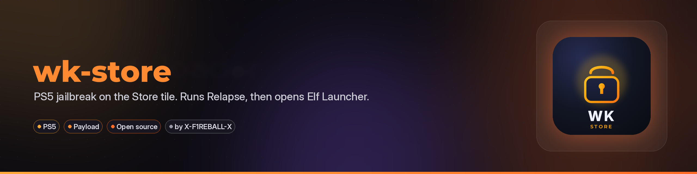
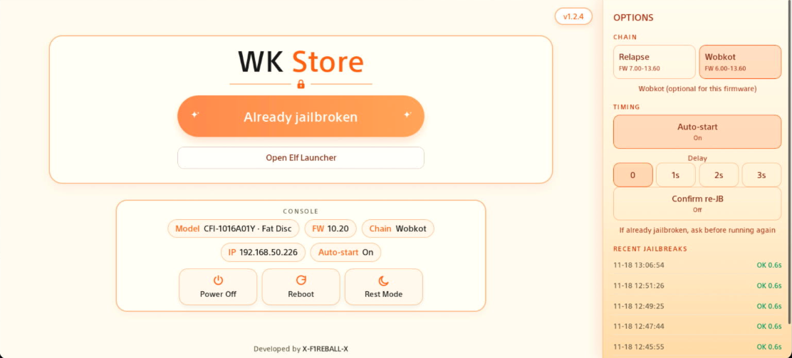

# WK Store

<p align="center">
  
</p>

Turns the PS5 Store tile into WK Store: open the tile, start the jailbreak, and Elf Launcher opens when it finishes.

## Quick start

**If WK Store is already installed, send Restore first.** That is required for a clean, stable install.

1. Send [`WK_Store_Restore_V1.2.4.elf`](https://github.com/X-F1REBALL-X/wk-store/releases/latest/download/WK_Store_Restore_V1.2.4.elf) to elfldr on port `9021`, then open elfldr again.
2. Send [`WK_Store_V1.2.4.elf`](https://github.com/X-F1REBALL-X/wk-store/releases/latest/download/WK_Store_V1.2.4.elf) to elfldr on port `9021`.
3. Wait for the install to finish. The console reboots on its own after Store finishes.
4. Open the **Store** tile and press **Start Jailbreak**.

Fresh console with no WK Store yet: skip step 1 and start from step 2.

## Features

- Replaces the Store tile with WK Store.
- Two jailbreak chains from the tile: **Wobkot** and **Relapse**.
- Elf Launcher opens by itself after a successful jailbreak.
- Works offline after install.
- Bundled Elf Launcher 2.1.6.
- A separate Restore ELF puts the original PlayStation Store tile back.

## Chains

- **Wobkot** (new in 1.2.4) - offsets for:
  - 6.00, 6.02
  - 7.00, 7.01, 7.20, 7.40, 7.60
  - 8.00, 8.20, 8.40, 8.60
  - 9.00, 9.20, 9.40, 9.60
  - 10.00, 10.20, 10.60
  - 11.00, 11.40, 11.60
  - 12.00, 12.20, 12.40, 12.60
  - 13.00, 13.20, 13.40, 13.60
- **Relapse** - 7.00 to 13.60

Wobkot jailbreak is about 0.6s on a good run.

## Gallery

<p align="center">
  
</p>

## Requirements

- PS5 firmware in the ranges above for the chain you pick.
- elfldr listening on port `9021`.

## Installation

Always send payloads one at a time. Wait between Restore and Store.

### Already have WK Store installed

Restore is required before installing again. Skipping it can leave a bad or unstable install.

1. Send [`WK_Store_Restore_V1.2.4.elf`](https://github.com/X-F1REBALL-X/wk-store/releases/latest/download/WK_Store_Restore_V1.2.4.elf) to elfldr on port `9021`.
2. Open elfldr again on port `9021`.
3. Send [`WK_Store_V1.2.4.elf`](https://github.com/X-F1REBALL-X/wk-store/releases/latest/download/WK_Store_V1.2.4.elf).
4. Wait until install finishes. Store reboots the console by itself.
5. Open the **Store** tile and press **Start Jailbreak**.

### Fresh install (no WK Store yet)

1. Send [`WK_Store_V1.2.4.elf`](https://github.com/X-F1REBALL-X/wk-store/releases/latest/download/WK_Store_V1.2.4.elf) to elfldr on port `9021`.
2. Wait until install finishes. Store reboots the console by itself.
3. Open the **Store** tile and press **Start Jailbreak**.

## Restore the PlayStation Store tile

Send [`WK_Store_Restore_V1.2.4.elf`](https://github.com/X-F1REBALL-X/wk-store/releases/latest/download/WK_Store_Restore_V1.2.4.elf) to elfldr on port `9021`. No reboot after Restore.

Use the same Restore before every Store upgrade when WK Store is already installed.

## Building from source

Needs the [PS5 payload SDK](https://github.com/ps5-payload-dev/sdk) with libmicrohttpd.

```bash
make store SDK=/path/to/ps5-payload-sdk
make restore SDK=/path/to/ps5-payload-sdk
```

Outputs `WK_Store_V1.2.4.elf` and `WK_Store_Restore_V1.2.4.elf`.

## License

[GNU GPL v3](LICENSE).

Third-party code keeps its own license where noted in the tree (for example MIT for [wobkot](https://github.com/ufm42/wobkot)).

## Credits

- [Wobkot](https://github.com/ufm42/wobkot) by [ufm42](https://github.com/ufm42)
- Relapse (PS5 WebKit / kernel chain)
- [Elf Launcher](https://github.com/ps5-payload-dev) / bundled Elf Launcher 2.1.6
- [PS5 payload SDK](https://github.com/ps5-payload-dev/sdk)

Developed by X-F1REBALL-X.
