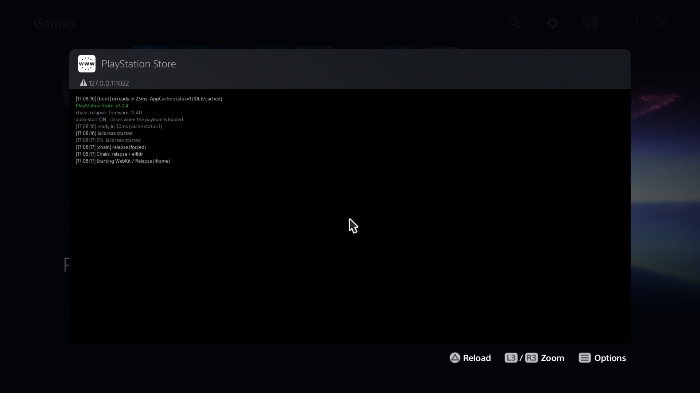

# PlayStation Store — Local Store Tile Jailbreak

<p align="center">
  
</p>

> ⚠️ **AI-generated project.** Code, art and docs were produced with an AI assistant. Original source code is available <a href="https://github.com/X-F1REBALL-X/wk-store">here</a>.

A native PS5 payload that turns the built-in **Store** tile into a local page.
Open the tile and it jailbreaks on its own, sends `pldmgr.elf` to elfldr, then
returns to the home screen. The whole UI and exploit chain are cached on the
console during install, so it keeps working offline.

- **Store tile → local UI.** Remaps the stock Store tile (`NPXS40047`) to
  `http://127.0.0.1:1022/app/index.html`.
- **Terminal UI.** The page is a black, append-only log — no buttons, no cards.
  Text appears as the jailbreak progresses.
- **Zero interaction.** Relapse is used, auto-start is on, and the page
  returns to the home screen by itself when the payload is loaded.
- **Offline.** The app and its chain are cached during install.
- **Reversible.** A separate Restore ELF puts the original PlayStation Store
  tile back.

<p align="center">
  
</p>

> This project is a fork of
> [wk-store](https://github.com/X-F1REBALL-X/wk-store) (GPLv3). All upstream
> branding was removed from the product; the original author is credited in
> [Credits](#credits).

## Contents

1. [How it works](#how-it-works)
2. [Requirements](#requirements)
3. [Install (prebuilt ELFs)](#install-prebuilt-elfs)
4. [Restore and clean](#restore-and-clean)
5. [Build your own ELF](#build-your-own-elf)
6. [Make it yours (branding)](#make-it-yours-branding)
7. [Development](#development)
8. [Project layout](#project-layout)
9. [FAQ](#faq)
10. [Credits](#credits) · [Disclaimer](#disclaimer) · [License](#license)

## How it works

1. You send `Store_V<version>.elf` to **elfldr on port 9021**.
2. The ELF starts a small HTTP server on **port 1022** and opens the PS5
   browser on it.
3. The browser caches the UI, both exploit chains and the payloads
   (`/wkal-cache.appcache`), then `/install` remaps the Store tile: it writes
   the tile artwork to `/user/appmeta/NPXS40047/` and updates the tile rows in
   `app.db` / `appinfo.db`.
4. The console reboots itself. From then on the Store tile serves the cached
   app, so the ELF is only needed again when you want to jailbreak.
5. Opening the tile later runs the cached chain again (**Auto-start** is on by
   default). When it succeeds the page sends `pldmgr.elf` to elfldr and closes
   the browser, leaving Payload Manager running — see
   [After the jailbreak](#after-the-jailbreak).

The page itself is a terminal: black background, monospace, and one line of
text per event (chain start, stages, progress, payload, result). It is built
from `frontend/autoloader/index.html` + `js/terminal.js`; the normal UI markup
is still in the DOM but hidden, because the jailbreak logic binds to it.

Ports used at runtime:

| Port | Service |
|---|---|
| 9021 | elfldr (you send payloads here) |
| 1022 | the app's local HTTP server |
| 8084 | Payload Manager (`pldmgr.elf`), after a successful jailbreak |

## Requirements

**On the console**

- A firmware supported by the chain you pick (see the table below).
- A payload sender that reaches elfldr on port 9021 (Payload Manager, the
  bundled PC host, netcat-style sender, …).

| Chain | Supported firmware |
|---|---|
| **Wobkot** | 6.00, 6.02, 7.00, 7.01, 7.20, 7.40, 7.60, 8.00, 8.20, 8.40, 8.60, 9.00, 9.20, 9.40, 9.60, 10.00, 10.20, 10.60, 11.00, 11.40, 11.60, 12.00, 12.20, 12.40, 12.60, 13.00, 13.20, 13.40, 13.60 |
| **Relapse** | 7.00 – 13.60 |

Wobkot is the faster chain (about 0.6 s on a good run). Relapse is the safer
default for firmware it supports.

## Install (prebuilt ELFs)

Send payloads **one at a time** and wait for each one to finish.

### Fresh console (nothing installed yet)

1. Send `Store_V1.2.4.elf` to elfldr on port `9021`.
2. Wait for the install to finish. The console reboots on its own.
3. Open the **Store** tile and press **Start Jailbreak**.

### Already installed (or an older build)

Restore first. Skipping this can leave a bad or unstable install.

1. Send `Store_Restore_V1.2.4.elf` to elfldr on port `9021`.
2. Open elfldr again on port `9021`.
3. Send `Store_V1.2.4.elf`.
4. Wait for the install to finish. The console reboots on its own.
5. Open the **Store** tile and press **Start Jailbreak**.

> The numbers in the file names come from `STORE_VERSION` in the `Makefile`
> (`1.2.4`) and from `elf_prefix` in `branding.json` (`Store`). Rebuild and
> you get whatever your branding says — see
> [Make it yours](#make-it-yours-branding).

## Restore and clean

| Payload | What it does | Reboots? |
|---|---|---|
| `Store_Restore_V1.2.4.elf` | Undoes the tile remap and puts the original PlayStation Store tile back (uses a backup when one exists, otherwise the built-in stock values). Also removes leftover files. | No |
| `Store_Clean_V1.2.4.elf` | For clean-console testing: backs up `ApplicationCache.db`, deletes only the Store origin (`http_127.0.0.1_1022`) rows and clears `manifest_ver` so the next install starts from an empty cache. | No |

Send either to elfldr on port `9021`. Run Restore **before every upgrade** when
the tile is already remapped.

## Build your own ELF

Everything is built with GNU Make. Nothing is downloaded automatically at build
time, so the same commands work offline once the prerequisites are in place.

### 1. What you need

| Tool | Why | Notes |
|---|---|---|
| Linux or macOS host | builds the ELFs | Windows: use WSL2 or the Docker image |
| [PS5 payload SDK](https://github.com/ps5-payload-dev/sdk) | `prospero-clang`, `prospero-strip`, PS5 headers/libs | default path `/opt/ps5-payload-sdk`, override with `SDK=...` |
| `libmicrohttpd` (static) | the app's HTTP server | `$(SDK)/target/lib/libmicrohttpd.a` — see [step 4](#4-optional-build-libmicrohttpd) |
| Python 3 | asset, registry and version generators | standard library only |
| Pillow **or** ImageMagick | regenerates `icon0`/`pic0`/logos from your picture | `make icons` |
| `openssl` CLI | self-signed cert for `make host` | only for the PC host script |
| `rsvg-convert` | optional: rebuild the default placeholder art | `make photo`/`make icons` do not need it |

The SDK's compiler name is checked at build time, so a wrong `SDK=` path fails
immediately with `prospero-clang: No such file or directory`.

### 2. Get the source

```bash
git clone https://github.com/<you>/<your-fork>.git
cd <your-fork>
```

No submodules are required for a normal build.

### 3. Payload binaries

Four payload binaries are embedded into the app cache. Three are prebuilt
upstream binaries, one is compiled from this repository. None of them are
stored in git (see `.gitignore`), so stage them once:

| Path | What it is |
|---|---|
| `frontend/autoloader/shared/elfldr-ps5.elf` | the elfldr the chain boots (listens on `:9021`) |
| `frontend/autoloader/payloads/payload.elf` | the bundled autoloader payload |
| `frontend/autoloader/payloads/pldmgr.elf` | Payload Manager — sent to elfldr after a successful jailbreak |
| `frontend/autoloader/payloads/wkal-companions.elf` | **built from this repo** — see below |

Where the prebuilt ones come from:

- **elfldr** — the `ps5-elfldr` release pinned by this tree (tag `v0.27-wk1`).
  The tree already ships the same bytes at
  `frontend/autoloader/relapse/payloads/elfldr-ps5-1360.elf`, so the simplest
  path is a copy:
  ```bash
  cp frontend/autoloader/relapse/payloads/elfldr-ps5-1360.elf \
     frontend/autoloader/shared/elfldr-ps5.elf
  ```
- **payload.elf** — the `ps5-unified-autoloader` release matching the pinned
  submodule tag.
- **pldmgr.elf** — the Payload Manager build you want to run. Drop your own
  copy at that path; `make payload-deps` only checks that it exists.

Download the matching release asset and drop it at the path above. Keep those
exact builds together: the exploit chains are pinned against them, and the
cached copy is what actually runs on the console.

Check what is missing:

```bash
make payload-deps
```

If the upstream submodules (`third_party/ps5-elfldr`,
`third_party/ps5-unified-autoloader`) are present, `tools/download_deps.sh`
fetches and verifies the pinned files for you:

```bash
git submodule update --init --recursive   # only if .gitmodules exists
bash tools/download_deps.sh
```

The fourth file is compiled here, so you never fetch it:

```bash
make companions-elf
```

### 4. (Optional) build libmicrohttpd

The Store build links the static library at
`$(SDK)/target/lib/libmicrohttpd.a`. If your SDK does not ship it yet, the
repository's `build_deps.sh` builds libmicrohttpd 1.0.1 with the PS5 compiler
and installs it into the SDK prefix:

```bash
sudo bash build_deps.sh
```

or, equivalently, with a custom SDK path and no root:

```bash
make dependencies SDK=$HOME/.local/ps5-payload-sdk
```

It installs into `$SDK/target` (default `/opt/ps5-payload-sdk/target`). It
needs `wget`, `make` and a usable `prospero-clang` on `PATH`. The Docker image
below does all of this for you.

### 5. Build

```bash
# the tile installer (this is the ELF you send to the console)
make store SDK=/opt/ps5-payload-sdk

# the "put the PlayStation Store tile back" payload
make restore SDK=/opt/ps5-payload-sdk

# optional: clean-console AppCache reset
make clean-elf SDK=/opt/ps5-payload-sdk
```

A normal `make store` also:

- regenerates `include/branding.h` from `branding.json`,
- regenerates the images from the icon/background masters if needed,
- stages the frontend and builds the compressed file registry,
- compiles `wkal-companions.elf` from source,
- builds SQLite once into `store/build/` and links everything.

Print the exact output name at any time:

```bash
make -s print-store-elf
```

### 6. What you get

| File | Purpose |
|---|---|
| `Store_V1.2.4.elf` | the Store-tile installer / launcher (send to `:9021`) |
| `Store_Restore_V1.2.4.elf` | restores the stock PlayStation Store tile |
| `Store_Clean_V1.2.4.elf` | resets the Store AppCache for testing |
| `frontend/autoloader/payloads/wkal-companions.elf` | post-JB companion installer (no homescreen tile) |
| `webkit-autoloader-host.py` | `make host` — single-file PC host with the frontend embedded |
| `installer.elf` | `make homescreen` — legacy homescreen installer (not the Store build) |

The `1.2.4` comes from `STORE_VERSION` in the `Makefile`; the `Store` prefix
comes from `branding.json`.

### 7. Make target reference

| Command | Result |
|---|---|
| `make` / `make all` | same as `make store` |
| `make store` | `Store_V1.2.4.elf` — the tile installer |
| `make restore` | `Store_Restore_V1.2.4.elf` — restores the stock tile |
| `make clean-elf` | `Store_Clean_V1.2.4.elf` — resets the Store AppCache |
| `make companions-elf` | builds `frontend/autoloader/payloads/wkal-companions.elf` |
| `make host` | `webkit-autoloader-host.py` (frontend embedded, needs `openssl`) |
| `make homescreen` | legacy `installer.elf` (homescreen app, not the Store remap) |
| `make icons` | regenerates every image from the icon/background masters |
| `make photo PHOTO=/path/pic.jpg` | imports your picture, then regenerates images |
| `make brand NAME="My Store"` | renames the product (see [branding](#make-it-yours-branding)) |
| `make dev` | local browser preview on `http://localhost:8123` |
| `make version` | regenerates `include/wkali_version.h` and `assets/param.json` |
| `make dependencies` | one-time build of libmicrohttpd into `$(SDK)/target` |
| `make print-version` | prints the full version string |
| `make print-store-elf` | prints the installer ELF name |
| `make payload-deps` | verifies the staged payload binaries |
| `make clean` | deletes generated headers, registry, ELFs and `frontend/dist` |

Every target accepts `SDK=/path/to/ps5-payload-sdk`.

If your SDK lives somewhere you cannot write to (a system-wide
`/opt/ps5-payload-sdk`), use a private copy and point `SDK=` at it:

```bash
cp -a /opt/ps5-payload-sdk ~/.local/ps5-payload-sdk
make dependencies SDK=$HOME/.local/ps5-payload-sdk   # one-time, needs network
make store SDK=$HOME/.local/ps5-payload-sdk
```

`make dependencies` is the one-time libmicrohttpd build described in
[step 4](#4-optional-build-libmicrohttpd); it is not needed with the Docker
image, which already contains the library.

### 8. Docker and release builds

`Dockerfile.sdk` builds a reproducible Ubuntu 24.04 toolchain: clang-18/lld,
the PS5 payload SDK and libmicrohttpd (`build_deps.sh`).

```bash
# one-off image build (takes a few minutes)
docker build -t ps5-webkit-autoloader-sdk -f Dockerfile.sdk .

# build the installer inside it
docker run --rm -u "$(id -u):$(id -g)" -v "$PWD":/src -w /src \
  ps5-webkit-autoloader-sdk make clean store
```

`build_release.sh` wraps that into a release build. It builds the image when
missing, runs `make clean store` inside it, then produces:

- `<elf_prefix>_payload.elf` — a copy of the versioned installer for GitHub
  releases,
- `store-host_v<version>.py` — the standalone PC host with the frontend and
  installer embedded.

```bash
BUILD_TYPE=stable bash build_release.sh
```

Docker mounts your working tree, so the payload binaries from
[step 3](#3-payload-binaries) must already be in place.

### 9. Version strings

There are two version numbers, on purpose:

| Where | What it controls |
|---|---|
| `include/wkali.h` → `WKAL_VERSION` | the app/cache version (`/app/<version>/`, `__complete__`). **Bump it when you change anything under `frontend/`.** |
| `Makefile` → `STORE_VERSION` | the installer version used in ELF names and the installer page |

The full build string is made by `tools/gen_version.py`:

```bash
BUILD_TYPE=dev          # default: 1.2.3-dev-<git hash>, or -dev-<timestamp> if the tree is dirty
BUILD_TYPE=stable       # 1.2.3
BUILD_TYPE=pre-release  # 1.2.3-pre-<git hash>
CUSTOM_VERSION=test1    # 1.2.3-test1 (also becomes the installed app title)
```

### 10. Troubleshooting

| Symptom | Fix |
|---|---|
| `Missing payload: frontend/...` | stage the four payloads — [step 3](#3-payload-binaries) |
| `libmicrohttpd.a: No such file or directory` | build/install it — [step 4](#4-optional-build-libmicrohttpd) |
| `prospero-clang: No such file or directory` | wrong or missing SDK: pass `SDK=/path/to/ps5-payload-sdk` |
| `Error: need Pillow or ImageMagick` | `pip install pillow`, or install ImageMagick |
| `rsvg-convert not found` | only needed for `--placeholder`; install `librsvg2-bin` or skip it |
| `make host` fails on `openssl` | install the OpenSSL CLI (`openssl req` is used for the cert) |
| Version ends in `-dev-<timestamp>` | your working tree is dirty; commit, or use `BUILD_TYPE=stable` |
| `make: Nothing to be done for 'store'` | outputs are up to date; run `make clean` to force a rebuild |
| Store tile still shows the old page | send `Store_Restore_V1.2.4.elf`, then reinstall and reboot |

## Make it yours (branding)

Every user-visible name and every generated image is derived from two things:
`branding.json` and two image masters (`assets/store-icon.png` for the tile
icon, `assets/store-bg.png` for the hover art). You never edit source code to
rebrand.

### Name, tagline and file names

`branding.json` (repo root):

```json
{
  "name": "PlayStation Store",
  "tagline": "JAILBREAK",
  "repo": "",
  "elf_prefix": "Store"
}
```

| Field | What it controls |
|---|---|
| `name` | PS5 tile label, page titles, the UI wordmark, installer/offline pages, update messages, PC host banner |
| `tagline` | the small uppercase line under the wordmark |
| `elf_prefix` | output file names: `Store_V1.2.4.elf`, `Store_Restore_V1.2.4.elf`, … |
| `repo` | `owner/repo` on GitHub. Enables the in-app update check and the PC host credit/update line. Empty = both disabled |

The browser/page title follows `name` (`PlayStation Store`, `… v1.2.4` on the
installer page).

Rename everything in one command, then rebuild:

```bash
make brand NAME="My Store" REPO="me/my-store"
make store
```

- `elf_prefix` is derived from `name` automatically: `My Store!` → `MyStore`.
- Want a different prefix? `make brand NAME="My Store" ELF_PREFIX="MS"`.
- Change only the tagline: `python3 tools/branding.py --set-tagline "JAILBREAK UI"`.
- The name is baked into the PS5 databases at install time, so **Restore and
  reinstall** after renaming.

### After the jailbreak

The post-jailbreak step is hardcoded: the page sends **`pldmgr.elf`** (Payload
Manager) to elfldr on `:9021`, waits until it answers on `:8084`, then returns
to the PS5 home screen.

```
Store tile → cached page → chain → elfldr :9021
           → pldmgr.elf sent (disk + bundled) → :8084 up → GET /api/home → closed
```

Details:

- Two send routes, because either can be blocked: the console copy the
  installer seeds (`/data/elf-launcher/elf-launcher.elf`) and the copy embedded
  in the app cache (`payloads/pldmgr.elf`, `?uri=`), so it works offline.
- The page does **not** close on a timer: it polls `:8084` for up to 12 s so a
  ~2.8 MB payload finishes loading first (closing earlier aborted the transfer).
  If nothing answers it still returns home, but shows
  “Payload Manager did not answer on :8084”.
- Wobkot runs as a top-level page (the Store page is replaced), so
  `wobkot/site.js` sends the payload itself and waits for `:8084` before leaving.
- The browser is dismissed by the native `ShellUIUtil navigateToHome` call
  (`GET /api/home`); `window.close()` is only a fallback.
- No `ELFL00001` (“Elf Launcher”) homescreen page is created: nothing opens
  `:1000` in this build.

To use a different payload, change one line — `frontend/autoloader/js/core.js`:

```js
W.POST_JB_PAYLOAD = 'pldmgr.elf';
```

…put that file in `frontend/autoloader/payloads/`, and update
`POST_JB_PAYLOAD` in the `Makefile` (it is the same path) so
`make payload-deps` checks it.

If you publish releases and want the in-app updater to find them, name the
release asset `<elf_prefix>_V<version>.elf` (for example
`MyStore_V1.3.0.elf`) and set `repo` to your repository.

### Your own pictures (stock look)

Two independent masters:

| Master | Used for |
|---|---|
| `assets/store-icon.png` | tile icon, in-page logo, favicons, `.ico`, Wobkot art |
| `assets/store-bg.png` | PS5 hover/focus art (`pic0` + `pic1`) and the README banner |

Install them with a single command each (any format / aspect ratio; each
output is centre-cropped, never stretched):

```bash
make icon PHOTO=/path/to/store-icon.png
make background PHOTO=/path/to/hover-art.png
make store
```

`make stock-bg` regenerates the neutral PS-blue gradient from
`assets/store-bg.svg` if you want a plain, stock-looking backdrop again.

**Hover art mode.** The Store build defaults to `STOCK_HOVER_ART=1`: it writes
**no** `pic0.png`/`pic1.png` and leaves the stock pic values in the database, so
the console draws its own background/detail art for the focused tile (and the
background master is only used for the README banner). To embed our own hover
art instead, build with:

```bash
make store STOCK_HOVER_ART=0 SDK=/path/to/ps5-payload-sdk
```

That writes `/user/appmeta/NPXS40047/pic0.png` + `pic1.png` and points the tile
rows at them (`store/config.h` → `STOCK_HOVER_ART`).

`make icons` regenerates every image from the current masters, and
`make photo PHOTO=...` still works as a fallback: it writes
`assets/home-photo.png`, which is used for any output whose dedicated master
is missing.

| Output | Size | Source | Used for |
|---|---|---|---|
| `store/pic0.png`, `assets/pic0.png` | 1920×1080 | bg | hover art — only embedded with `STOCK_HOVER_ART=0` |
| `store/icon0.png`, `assets/icon0.png` | 512×512 | icon | Store tile art + installed app icon |
| `assets/icon.ico` | 16–256 | icon | Windows icon for the host tooling |
| `frontend/*/logo.png` | 512×512 | icon | in-page wordmark art |
| `frontend/*/favicon.png` | 256×256 | icon | browser tab icon |
| `frontend/autoloader/store-tile-icon.png` | 128×128 | icon | small tile art in the UI |
| `frontend/autoloader/wobkot/jb-lock.png` | 256×256 | icon | chain progress art |
| `docs/img/banner.png` | 1600×400 | bg | README banner |

All outputs are saved as 256-colour PNGs so the images embedded in the ELF
stay small.

Restore the built-in placeholder artwork at any time:

```bash
python3 tools/gen_brand_assets.py --placeholder
```

`make icons` needs Pillow or ImageMagick. `--placeholder` additionally needs
`rsvg-convert`. Commit the regenerated PNGs if you want your pictures in git.

### How the branding reaches the code (for contributors)

1. `branding.json` → `tools/branding.py --write-header` →
   `include/branding.h` (`BRAND_NAME`, `BRAND_TAGLINE`, `BRAND_REPO`,
   `BRAND_ELF_PREFIX`). The header is generated and gitignored.
2. The C code uses `BRAND_NAME` (for example `store/config.h` sets
   `TILE_LABEL` to it).
3. The static frontend uses build-time tokens:
   `[[BRAND_NAME_PLACEHOLDER]]`, `[[BRAND_TAGLINE_PLACEHOLDER]]`,
   `[[BRAND_REPO_PLACEHOLDER]]`, `[[BRAND_ELF_PREFIX_PLACEHOLDER]]`.
   They are substituted by `tools/gen_file_registry.py` (ELF build),
   `tools/build_host.py` (PC host) and `tools/dev_server.py` (local preview).
4. `tools/gen_brand_assets.py` reads `assets/store-icon.png` (square outputs)
   and `assets/store-bg.png` (hover art), falling back to
   `assets/home-photo.png`, and writes every image listed above.

Rule of thumb: never hardcode the product name — use `BRAND_NAME` in C and a
`[[BRAND_*]]` token in HTML/JS/CSS.

## Development

### Local preview

```bash
make dev                 # http://localhost:8123
python3 tools/dev_server.py --port 9000 --no-open
```

The dev server mirrors the real build: it maps `/app/*` to the frontend
directory and substitutes the version and branding tokens. It needs the payload
binaries staged ([step 3](#3-payload-binaries)).

### Tests

```bash
node tests/test_launcher_recovery.js
```

Requires Node.js and `frontend/autoloader/payloads/elf-launcher.elf` (the test
extracts the embedded launcher HTML from that payload). The Store build no
longer ships that file, so treat this as an optional legacy test.

### Frontend layout

| Directory | Role |
|---|---|
| `frontend/installer-page/` | cache/progress page served at the site root during install |
| `frontend/pointer/` | stable `/app/index.html`; verifies the `__complete__` marker, then redirects into the versioned app directory |
| `frontend/autoloader/` | the actual app: UI in `js/`, chains in `relapse/` and `wobkot/`, vendored code in `*/vendor/` |

At build time these are staged into `frontend/dist/` and compressed into
`include/file_registry.c`, so the console serves everything from memory and
caches it via `/wkal-cache.appcache`.

## Project layout

```text
.
├── branding.json          product name, tagline, repo, ELF prefix
├── assets/                icon/background masters, generated art, app metadata
├── docs/                  README banner
├── frontend/              installer page, pointer page, the app UI and chains
├── include/               C headers (branding.h and file_registry.* are generated)
├── pc-host/               standalone DNS + HTTPS host for the initial install
├── src/                   installer ELF (HTTP server, app installer, launcher)
├── store/                 Store-tile remap, restore, clean + embedded SQLite
├── tests/                 Node test for the launcher recovery logic
├── tools/                 branding/version/registry/image/host generators
├── Makefile               all build targets
└── build_release.sh       Docker release build
```

## FAQ

**Do I really have to Restore before reinstalling?**
Yes, when the tile is already remapped. It resets the tile rows and the
AppCache so the new build starts clean. Skipping it can leave an unstable
install.

**Does the ELF have to stay running?**
No. It is needed to install and to run a jailbreak. After install, the cached
app opens from the Store tile on its own.

**Does it work offline?**
Yes. The app, both chains and the payloads are cached during install.

**Can I change the payload that loads after the jailbreak?**
Yes. It is `W.POST_JB_PAYLOAD` in `frontend/autoloader/js/core.js` (currently
`pldmgr.elf`). Put the new file in `frontend/autoloader/payloads/`, update the
matching `POST_JB_PAYLOAD` path in the `Makefile`, and rebuild. Keep elfldr as
shipped — the chains are pinned against it.

**Why does my version end in `-dev-...`?**
Dev builds append the git hash (or a timestamp when the tree is dirty). Use
`BUILD_TYPE=stable` for a clean version.

**Where is the tile name stored on the console?**
In `app.db` / `appinfo.db` (`TITLE`, `concept_name`, `hubAppUri`, …) plus the
artwork in `/user/appmeta/NPXS40047/`. The installer writes all of it, which is
why a rename needs Restore + reinstall.

**Nothing builds and it complains about payloads.**
That is expected on a fresh clone: the four payload binaries are not in git.
See [step 3](#3-payload-binaries).

## Credits

This project is a fork of
[wk-store](https://github.com/X-F1REBALL-X/wk-store) by X-F1REBALL-X (GPLv3).
The upstream name and author are kept here for attribution only; they are not
shown anywhere in the app or on the console.

- [Wobkot](https://github.com/ufm42/wobkot) by [ufm42](https://github.com/ufm42) — MIT
- Relapse (PS5 WebKit / kernel chain)
- Payload Manager (`pldmgr.elf`) — user-supplied payload
- [PS5 payload SDK](https://github.com/ps5-payload-dev/sdk)
- elfldr payload — `ps5-elfldr` (tag `v0.27-wk1`)
- bundled autoload payload — `ps5-unified-autoloader`

## Disclaimer

Jailbreaking, sideloading and modifying your console's system databases are
not supported by Sony. Use this on your own hardware, at your own risk, and
keep a way to restore the original Store tile (`Store_Restore_*.elf`).

## License

[GNU GPL v3](LICENSE). Third-party code keeps its own license where noted in
the tree (for example MIT for Wobkot).

